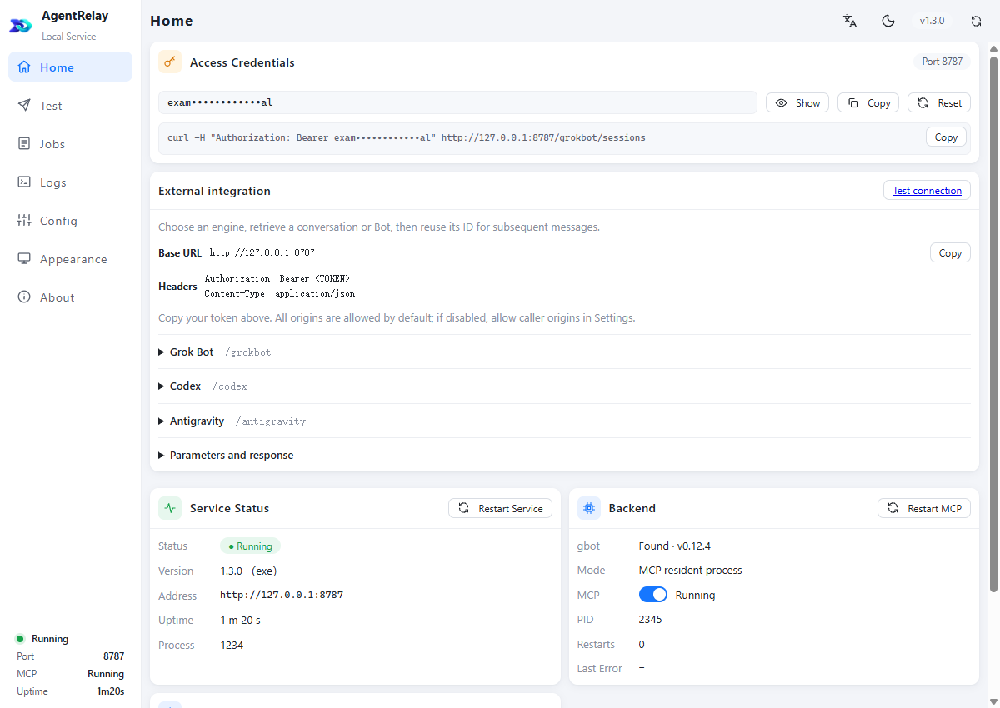
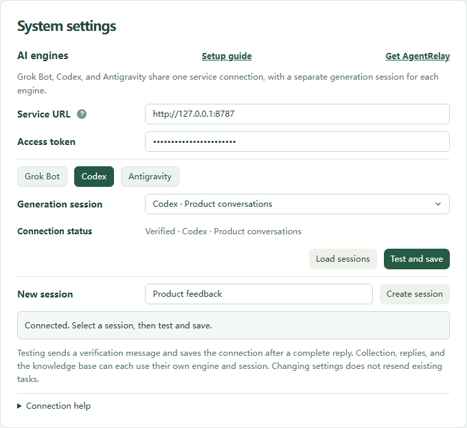

# AgentRelay

**A local AI hub for your extensions, apps and workflows.**

AgentRelay connects compatible tools to Codex, Grok Bot and Antigravity on your computer. Choose an existing conversation or Bot, send a task, then continue the same conversation.

**[Free Local AI Hub — AgentRelay by GoodExts](https://goodexts.com/)** · [中文介绍](https://goodexts.com/zh) · [Contact / 联系我们](https://goodexts.com/contact-us)

Give compatible extensions, desktop apps and web workflows a shared AI engine. AgentRelay brings your supported AI clients together behind one local address, so each tool can send work to a chosen conversation without rebuilding its context for every message.

AgentRelay 是 GoodExts 产品生态的本地 AI 动力引擎：为插件、其他客户端和网页工作流提供统一接入，让采集分类、内容辅助、知识整理等任务交给指定会话持续处理。GoodExts 首页是产品主入口，插件是具体落地场景。

## See it in action / 产品与接入示例

The AgentRelay dashboard shows the local service address, access credentials and engine endpoints. Actual 1.3.0 UI with example data; no live credentials are shown.

XFollower is an X workflow extension for organizing posts, classification and assisted replies. It can use AgentRelay to route different tasks to dedicated AI conversations. This example shows the connection and conversation selector, using demonstration data. **[Contact GoodExts about XFollower](https://goodexts.com/contact-us)**.

XFollower 是面向 X 运营的工作流插件，可将帖子整理、采集打标和辅助回复等任务接入 AgentRelay，给不同任务分配不同会话。上图为示例配置；如需了解 XFollower，请通过 GoodExts 联系我们。

## Download / 下载

**[Download the latest release / 下载最新正式版](https://github.com/wangsen2020/grok-bot-bridge/releases/latest)**

- Windows 10 / 11, x64.
- Installer: `agent-relay-<version>-setup-x64.exe`.
- Portable package: `agent-relay-<version>-win-x64.zip`.
- Standalone desktop: `agent-relay.exe`; service only: `agent-relay-service.exe`.
- `SHA256SUMS.txt` contains file checksums. `update-manifest.json` is the signed in-app update manifest.

GitHub's automatic **Source code** archives contain only this download catalog. Choose an application file under **Assets** to run AgentRelay.

## Quick start / 开始使用

1. Install or extract AgentRelay, then open the desktop application.
2. Open and sign in to the AI client you want to use. Codex requires the local CLI; Antigravity requires the IDE. AgentRelay includes its Grok Bot adapter and Antigravity bridge dependencies.
3. Select an engine and conversation in the test page and send a small test task.
4. For a compatible extension or app, copy the service address and access token from the AgentRelay dashboard. The default address is `http://127.0.0.1:8787`.

AgentRelay itself is free software to use. AI accounts, subscription terms, usage limits and any AI service charges still apply. The service runs locally; the selected AI provider may process requests in the cloud.

## 外部接入

The three engine prefixes are `/grokbot`, `/codex` and `/antigravity`. Business API requests require `Authorization: Bearer <token>`.

| Action | Endpoint |
| --- | --- |
| List conversations / 列出会话 | `GET /<engine>/sessions` |
| Create a conversation / 创建会话 | `POST /codex/sessions` or `POST /antigravity/sessions` |
| Submit a task / 提交任务 | `POST /<engine>/jobs` |
| Read task progress and result / 查询任务 | `GET /<engine>/jobs/<jobId>` |

Use the selected conversation ID for repeated messages. Grok Bot uses an existing Bot. Legacy Grok Bot endpoints remain compatible.

## Updates / 更新

From version 1.1.0 onward, check for updates in the application settings. The updater waits for active tasks, backs up local data and supports rollback on failure. Earlier versions require a manual installation.

This repository keeps its historical URL so existing installations can continue to check for updates. Published application files, checksums and signed manifests are retained.

## Distribution / 发行说明

This public repository contains product information and binary releases only. AgentRelay source code and development history are maintained separately in a private repository. Third-party components retain their own licenses, supplied with the application.

本仓库仅用于提供产品说明、安装包、校验文件和更新清单。AgentRelay 源码与开发历史已迁入私有仓库，不通过此仓库提供。第三方组件许可随软件保留。

**[Contact GoodExts / 联系我们](https://goodexts.com/contact-us)**
